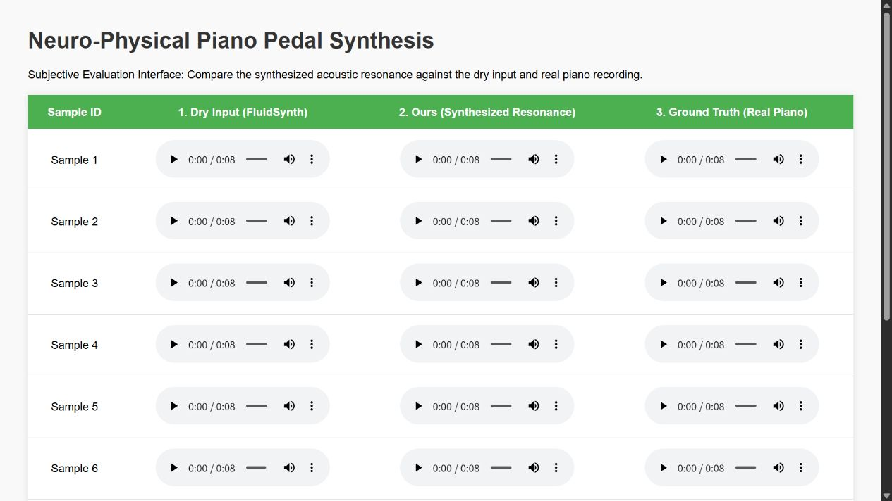

<div align="center">

# NPPS · Neuro-Physical Piano Synthesis

**Piano sustain synthesis through neural perception and mechano-acoustic priors.**

[](https://xiaofei1412.github.io/NPPS-Demo/)
[](https://pytorch.org/)
[](LICENSE)

[Live demo](https://xiaofei1412.github.io/NPPS-Demo/) · [How it works](#how-it-works) · [Getting started](#getting-started) · [Research notes](docs/RESEARCH_NOTES.md)

</div>

NPPS is a PyTorch research prototype for adding sustain-pedal effects to synthesized dry piano audio. A U-Net estimates pedal intent; local hysteresis and asymmetric inertia convert that estimate into a continuous damper-control trajectory; a DSP engine renders resonance, harmonic excitation, and mechanical noise.

Developed from an undergraduate final-year project, the work explores **interpretable intermediate controls for neural audio synthesis**. The accompanying manuscript, *Mitigating Physical Incoherence in Data-Driven Piano Synthesis via Mechano-Acoustic Constraints*, is an **unpublished research manuscript**.

## Listen to the demo

**[Open the interactive audio comparison →](https://xiaofei1412.github.io/NPPS-Demo/)**

Compare ten excerpts side by side: **Dry Input (FluidSynth)**, **NPPS Synthesized Resonance**, and **Real Piano Recording**. Each player can be auditioned directly on the demo page.

[](https://xiaofei1412.github.io/NPPS-Demo/)

*Click the preview to open the live players. The real piano recordings are listening references; this page is a labeled comparison, not a blinded perceptual study.*

## How it works


| Stage | Implementation | Purpose |
| --- | --- | --- |
| Neural perception | Log-Mel spectrogram → U-Net PedalNet → frame-level pedal intent | Estimate a control trajectory from dry audio, with 10 ms feature spacing at 16 kHz. |
| Mechanical interface | Local Context-Aware Schmitt Trigger (LCAST) + asymmetric first-order inertia | Reduce rapid switching and produce a continuous damper-control signal. |
| Acoustic rendering | Frequency-dependent dual-stage decay, harmonic excitation, FFT convolution, and motion-driven noise | Add pedal-dependent resonance while retaining the dry signal. |

The research contribution is the explicit separation of **control-trajectory behavior** and **acoustic response**. The current implementation trains the perception network separately and applies fixed, physics-inspired rendering rules. It is an offline research system; the mechanical stage uses NumPy operations outside the gradient graph.

## Getting started

Run commands from the repository root. Install a compatible Python environment and a matching PyTorch/torchaudio build for your CPU or CUDA setup.

```bash
git clone https://github.com/xiaofei1412/My-Neuro-Physical-Piano.git
cd My-Neuro-Physical-Piano
python -m pip install -r requirements.txt
```

**For audio rendering:** install the [FluidSynth command-line program](https://www.fluidsynth.org/) and make `fluidsynth` available on `PATH`. Obtain a separately licensed SoundFont and place it at `piano.sf2`. The local development asset identifies itself as **GeneralUser GS 1.472 by S. Christian Collins**; see [third-party notices](THIRD_PARTY_NOTICES.md) for its license and provenance. A different SoundFont changes the synthesized data and results.

### 1. Prepare MAESTRO and dry audio

Download [MAESTRO v3.0.0 from its official source](https://magenta.tensorflow.org/datasets/maestro). Extract its metadata, MIDI files, and original directory structure under `data/maestro-v3.0.0/`. Original recordings are also needed for real-audio comparisons. Dataset files are distributed under **CC BY-NC-SA 4.0**, separately from the code.

```text
My-Neuro-Physical-Piano/
├── data/
│   ├── maestro-v3.0.0/          # Metadata, MIDI, and original WAV files
│   ├── maestro_dry/            # Generated dry WAV files
│   └── maestro_wet_fluidsynth/ # Optional MIDI-controlled FluidSynth baseline
├── checkpoints/               # Locally trained model weights
├── configs/default.yaml
└── piano.sf2                  # Separately obtained SoundFont
```

```bash
python src/prepare_dry_dataset.py
python scripts/prepare_fluidsynth_wet.py
```

The first command removes MIDI CC64 events and disables FluidSynth reverb/chorus. The optional second command retains CC64 and enables those effects to create a MIDI-controlled baseline. Both scripts preserve the dataset's relative file layout and render at 16 kHz.

### 2. Train PedalNet

Check the data paths and training settings in [`configs/default.yaml`](configs/default.yaml), then run:

```bash
python scripts/train.py --config configs/default.yaml
```

The current training code regresses normalized MIDI CC64 values using **MSE + 0.1 × L1**, AdamW, and cosine learning-rate scheduling. The default configuration uses 4-second training crops, batch size 16, and 100 epochs. The best validation checkpoint is saved to `checkpoints/best_pedal_net.pth`.

**Weights are not included in Git and no public checkpoint download is provided in this repository.** Train first, or supply a compatible checkpoint obtained separately.

### 3. Synthesize a dry recording

```bash
python scripts/inference.py --config configs/default.yaml --ckpt checkpoints/best_pedal_net.pth --input path/to/dry_piano.wav --output output_wet.wav
```

The input is loaded as mono audio at 16 kHz. Use a dry piano excerpt similar to the synthesized training inputs; pedal intent inferred from dry audio is an estimate, rather than recovery of a uniquely observable performance.

### 4. Explore evaluation and listening tools

| Task | Entry point |
| --- | --- |
| Control smoothness (TV/DIR) and peak high-frequency gain | `python scripts/evaluate_mechanics.py --config configs/default.yaml --ckpt checkpoints/best_pedal_net.pth` |
| Historical FAD/RMS evaluation and ablation modes | [`scripts/evaluate.py`](scripts/evaluate.py) — read the [evaluation caveats](docs/RESEARCH_NOTES.md#evaluation-caveats) before interpreting results. |
| Generate a local labeled listening comparison | `python scripts/prepare_listening_test.py --samples 10 --ckpt checkpoints/best_pedal_net.pth` |
| Mechanism and spectrum illustrations | [`notebooks/generate_paper_figures.ipynb`](notebooks/generate_paper_figures.ipynb) |

The listening generator writes `listening_test/index.html` and its audio files. The notebook includes synthetic control experiments. Historical manuscript measurements, implementation differences, and reproducibility limits are documented in the [research notes](docs/RESEARCH_NOTES.md).

## Repository map

```text
src/
├── dataset.py                 # Paired dry-audio / MIDI CC64 loading
├── prepare_dry_dataset.py     # Pedal-free MIDI rendering
├── losses.py                  # Control regression and spectral loss definitions
└── models/
    ├── pedal_net.py           # U-Net perception frontend
    ├── mechanism.py           # LCAST, inertia, and motion envelopes
    └── acoustics.py           # Decay IR, harmonic exciter, and FFT rendering
scripts/                       # Training, inference, evaluation, and listening tools
configs/                       # Experiment configuration
notebooks/                     # Research visualizations
docs/                          # Research notes and demo preview
```

## Citation

Please cite this repository as research software. The manuscript has no proceedings publication entry or DOI in this repository.

```bibtex
@misc{chen2026npps,
  title        = {NPPS: Neuro-Physical Piano Synthesis},
  author       = {Chen, Xiaofei and Li, Shengchen},
  year         = {2026},
  howpublished = {Research software},
  url          = {https://github.com/xiaofei1412/My-Neuro-Physical-Piano}
}
```

Please also cite the [MAESTRO dataset paper](https://magenta.tensorflow.org/datasets/maestro#how-to-cite) when using its data.

## License and attribution

Original source code is available under the [MIT License](LICENSE). MAESTRO data, derived audio, SoundFonts, and third-party dependencies retain their own applicable terms; the code license does not replace them. See [Third-party notices](THIRD_PARTY_NOTICES.md).
